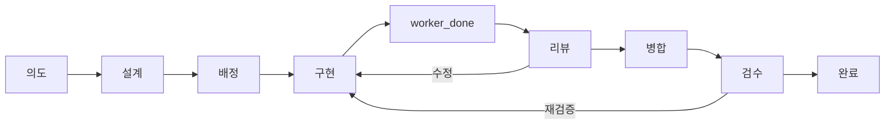

# 과제 흐름 그래프

FullOps 과제 생명주기의 노드·엣지·게이트 명세다. 의도: [FLOW-GRAPH-001](intents/FLOW-GRAPH-001.md) S1·S2. hook·스크립트의 게이트를 바꾸면 이 표도 고친다. `tests/flow-graph.py`가 표의 게이트 함수가 `plugins/fullops-squad/scripts/`에 있는지, "비어 있음" 엣지 수가 처음 수를 넘지 않는지 확인한다.

## 노드

| 노드 | 책임 | 주체 |
|---|---|---|
| 의도 | 묶음 작업의 문제·성공 기준·범위를 정하고 사용자 승인을 받는다 | coordinator·사용자 |
| 설계 | route를 정하고 역할별 지시서를 쓴다 | coordinator(simple)·설계 역할(design) |
| 배정 | 역할 인박스 지시서를 담당 worktree의 worker에게 `worker-start --run`으로 보낸다 | coordinator |
| 구현 | 지시서 범위를 구현·검증하고 커밋한다 | worker |
| worker_done | 브랜치·SHA·검증 결과를 coordinator에게 보낸다 | worker |
| 리뷰 | 고정 SHA를 다른 세션이 독립 리뷰한다 | 리뷰 세션 |
| 병합 | 리뷰한 SHA를 기본 브랜치에 병합·push하고 worktree를 동기화한다 | coordinator |
| 검수 | 묶음 의도의 성공 기준을 고정 시나리오로 판정한다 | tester·coordinator |
| 완료 | 완료 보고를 로그에 보존하고 PLANS·현황판을 갱신한다 | coordinator |

## 엣지

게이트는 `파일.py:함수`로 적는다. 강도는 차단(PreToolUse deny·Stop block)이나 알림(additionalContext)이다. 게이트가 없으면 "비어 있음"과 채울 과제를 적는다.

| ID | 전환 | 조건 | 넘기는 산출물 | 게이트 | 강도 |
|---|---|---|---|---|---|
| E1 | 요청 → 의도 | 과제 2개 이상이나 역할 2개 이상에 걸친다 | `docs/planning/intents/<묶음 키>.md` | 비어 있음(coordinator 지침 문장만 있다. #82) | |
| E2 | 의도 → 설계 | intent `status: approved` | 승인된 intent | 비어 있음(승인 전 배정 확인. #82) | |
| E3 | 설계 → 배정 | route 기록이 있고 지시서 첫 줄이 `# <과제 키> — <목표>` | `handovers/to_<역할>.md`, `<키>-route.json` | `flow_gate.py:handover_denial`, `flow_gate.py:inbox_denial` | 차단 |
| E4 | 배정 → 구현 | 분류된 과제 키, 역할 인박스, 최신 기본 브랜치를 가진 등록 worktree, 남은 통합 없음 | dispatch spec(지시서 경로·기준 SHA) | `flow_gate.py:route_key_denial`, `flow_gate.py:dispatch_inbox_denial`, `integration.py:baseline_denial`, `integration.py:denial`, `flow_gate.py:delegation_denial` | 차단 |
| E5 | 구현 → worker_done | 현재 HEAD의 lint 통과, 작업 트리 깨끗함, 보고서가 링크한 캡처만 커밋 | 커밋, lint 통과 기록 | `done_gate.py:main`, `lint.py:stamp`, `harness_gate.py:unlinked_media`, `harness_gate.py:round_folder` | 차단 |
| E6 | worker_done 송신 | dispatch 세션은 끝나기 전에 `worker_done`·`ask`·`escalation` 중 하나를 보낸다 | `worker_done` 메시지 | `flow_gate.py:settled_in_runtime`, `flow_gate.py:delivered` | 차단 |
| E7 | worker_done 형식 | 메시지에 브랜치·SHA가 있고 lint 통과 HEAD가 보고 SHA와 같다 | 완료 보고 | `integration.py:boundary_notes`, `integration.py:lint_drift`, `integration.py:take_notes` | 알림 |
| E8 | worker_done → 리뷰 | coordinator가 Run의 메시지를 받아 통합 대기에 기록하고 리뷰 필요성을 판정한다 | 통합 기록, `review.py need` 판정 | `flow_gate.py:run_state`, `integration.py:record`, `review.py:need` | 차단 |
| E9 | 리뷰 판정 기록 | 모든 병합에 리뷰 필요성 판정 또는 면제 기록이 남는다 | `review.py need` 결과·`waive` 기록 | 비어 있음(KnowsLink 병합 193건 중 149건 기록 없음. #82) | |
| E10 | 리뷰 → 병합 | 기록 검사 통과, 독립 세션, critical/high 미해결 없음 | `qa-reports/<키>-review/result.json` | `review.py:check`, `review.py:check_independence`, `review.py:direct_check` | 차단 |
| E11 | 병합 SHA | 병합하는 SHA가 리뷰한 SHA와 같다 | 병합 커밋 | `integration.py:merge_drift` | 알림 |
| E12 | 병합 → 다음 배정 | 완료 결과가 기본 브랜치에 통합됐거나 hold 사유가 있다 | 기본 브랜치 SHA | `integration.py:denial` | 차단 |
| E13 | 병합 → 검수 | 묶음의 과제가 모두 병합됐다 | intent 성공 기준, 시나리오 | 비어 있음(#82) | |
| E14 | 리뷰·검수 → 구현(수정·재검증) | 같은 과제 키로 다시 연다. 보고서는 기존 폴더에 덧붙인다 | 기존 지시서·report.md | `work.py:new`, `harness_gate.py:round_folder` | 차단 |
| E15 | 반복 예산 | 같은 과제의 수정·재검증이 2회를 넘으면 사람에게 올린다 | 반복 횟수·같은 실패 항목 | 비어 있음(G4, S4) | |
| E16 | 검수·병합 → 완료 | 완료 보고 전문을 로그에 보존한 뒤 인박스를 비운다. PLANS가 바뀌면 현황판 단계도 고친다 | `handovers/logs/`, `board/board.json` | `work.py:finish`, `flow_gate.py:board_reminder`, `board.py:write` | 차단 |
| E17 | 보고서 분량 | 테스트 레벨 minimal·lite에서 폭·테마 캡처 요구와 40줄 넘는 report.md를 줄인다 | report.md | `harness_gate.py:advice` | 알림 |

처음 비어 있음 엣지: 7개(2026-10-23). 지금 5개(E7·E11을 알림으로 채움)

## 제어 상태

지금은 상태가 세션별 hook 파일(`.git/fullops-gate/flow-<세션>.json`), route 기록, 통합 기록, 인박스에 흩어져 있다. 과제 단위 상태 파일은 G5(S5)에서 만든다.
