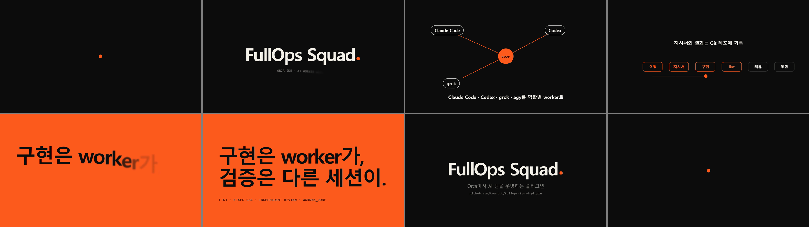

# 15초 소개 영상

[`fullops-intro.mp4`](fullops-intro.mp4)는 FullOps Squad를 소개하는 15초 영상이다. 1920×1080, 60fps, 무음이다. `fullops-motion`의 기본 경로(템플릿 → 단일 HTML → `render.mjs`)로 만들었고, 소스는 [`index.html`](index.html) 하나다.



| 시간 | 장면 |
|---|---|
| 0–2초 | 주황 점이 맥동하다 "FullOps Squad"의 마침표가 된다 |
| 2–5초 | 점이 `coor`가 되고 Claude Code·Codex·grok·agy가 비트마다 연결된다 |
| 5–8.5초 | 점이 요청 → 지시서 → 구현 → lint → 리뷰 → 통합을 한 박자씩 지난다 |
| 8.5–11초 | 점이 화면을 채우고 "구현은 worker가, 검증은 다른 세션이."가 뜬다 |
| 11–15초 | 엔드카드 후 처음의 점으로 돌아가 루프한다 |

## 출처

구조는 `fullops-motion/templates.md`의 #3 "연결 요소 하나로 이어지는 모션 시스템"과 #7의 훅 → 기법 → 마무리 순서를 따랐다.
참고: Orange dot kinetic motion system by [@rossaxbt](https://x.com/rossaxbt/status/2108570705692357094), 15-second motion design showreel by [@darel023](https://x.com/darel023/status/2103424524297420829).

## 다시 렌더하기

Node 20 이상, `playwright`(또는 `playwright-core`와 시스템 Chrome), FFmpeg가 필요하다. 브라우저에서 `index.html`을 열면 실시간으로 재생된다.

```bash
npm i -D playwright-core          # 렌더할 작업 폴더에서
node plugins/fullops-squad/skills/fullops-motion/render.mjs docs/intro/index.html --stills 0,1.2,3.6,7,9.6,12.9 --out qa/intro/stills --width 1920 --height 1080 --channel chrome
node plugins/fullops-squad/skills/fullops-motion/render.mjs docs/intro/index.html --out renders/intro.mp4 --width 1920 --height 1080 --fps 60 --duration 15 --subframes 2 --channel chrome
```

2026-10-17, Windows 11, Node 24.13.0, playwright-core 1.49.1, Chrome, FFmpeg 8.0.1에서 렌더했다(약 3분, 900프레임). 문구와 시각은 `seek(t)` 안의 상수에서 바꾼다.

## 한계

- 글꼴은 시스템의 맑은 고딕과 Consolas를 이름으로 참조한다. 다른 OS에서는 대체 글꼴로 렌더되고, 영상을 외부에 배포하려면 재배포가 허락된 글꼴로 바꿔야 한다.
- 음악이 없다. 비트 간격은 120BPM 기준으로만 맞췄다.
- 첫 프레임과 마지막 프레임은 눈으로 보면 같지만 바이트까지 같지는 않다.
